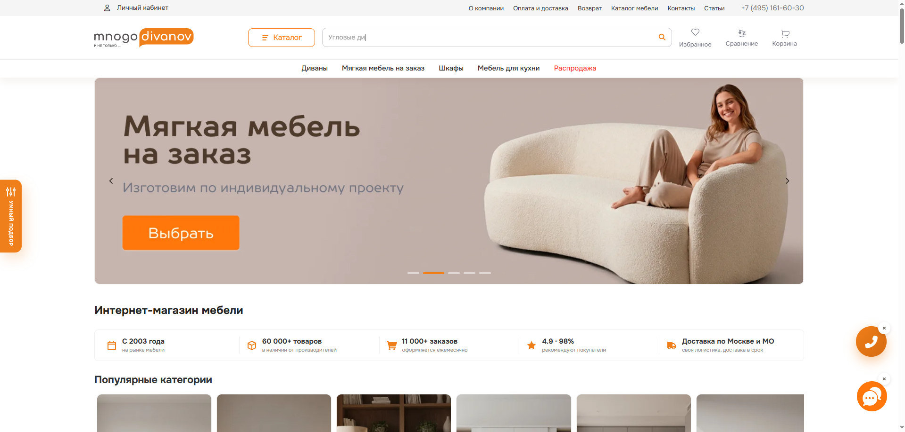
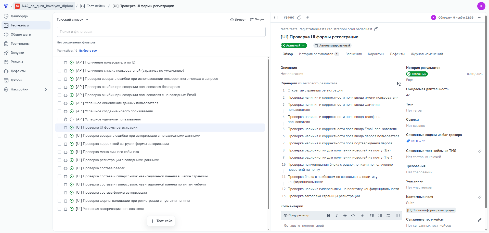
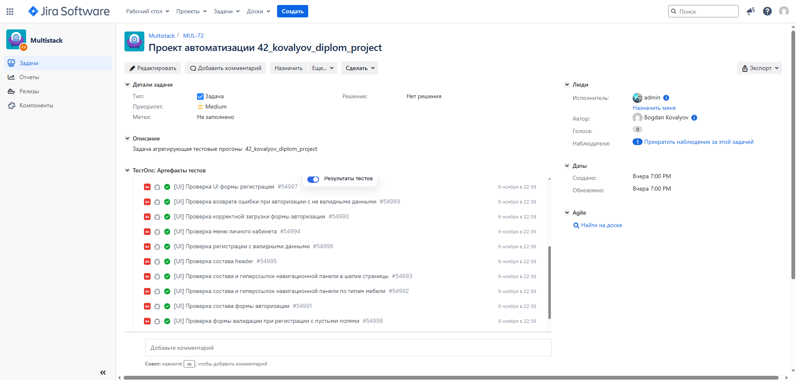
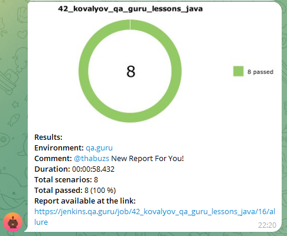

# 🛋️ Автотесты для сайта «Много Диванов»

Автоматизированное тестирование интернет-магазина мебели [«Много Диванов»](https://www.mnogodivanov.ru/)

<div align="center">
  
</div>

---

## 📋 Содержание

- [🛠️ Технологии и инструменты](#️-технологии-и-инструменты)
- [✅ Примеры автоматизированных тест-кейсов](#-примеры-автоматизированных-тест-кейсов)
- [⚙️ Сборка Jenkins](#️-сборка-jenkins)
- [💻 Запуск автотестов](#-запуск-автотестов)
- [📊 Allure отчет](#-allure-отчет)
- [🧪 Интеграция Allure TestOps](#-интеграция-allure-testops)
- [🔗 Интеграция с Jira](#-интеграция-с-jira)
- [📨 Уведомления в Telegram](#-уведомления-в-telegram)
- [🎥 Пример видео Selenoid тестов в Allure отчете](#-пример-видео-selenoid-тестов-в-allure-отчете)

---

## 🛠️ Технологии и инструменты

| 🧩 Инструмент | 🎯 Назначение |
|---|---|
| ☕ **Java** | Язык написания автотестов |
| 🧪 **JUnit 5** | Фреймворк модульного тестирования |
| 🐘 **Gradle** | Система автоматической сборки |
| 🏗️ **Jenkins** | Удалённый запуск с выбором параметров тестирования |
| 📊 **Allure** | Формирование отчетов о пройденных тестах |
| 📨 **Telegram Bot** | Отправка отчетов о тестировании в мессенджер |
| 🧬 **Allure TestOps** | Интеграция с системой управления тестированием |
| 🔗 **Jira Software** | Интеграция с трекером задач |

---

## ✅ Примеры автоматизированных тест-кейсов

- 🔐 Функциональные проверки формы регистрации
- 🎨 Проверки UI формы регистрации
- 🏠 Проверки UI на главной странице сайта
- 🔑 Функциональные проверки формы авторизации
- 🖌️ Проверки UI на форме авторизации

---

## ⚙️ Сборка [Jenkins](https://jenkins.qa.guru/view/java_students/job/42_kovalyov_final_ui_tests/)

<div align="center">
  <!-- 🖼️ Сюда вставь скриншот сборки Jenkins -->
  
</div>

### 🎛️ Параметры сборки

- 🌐 BROWSER (браузер, по умолчанию chrome)
- 🔢 BROWSER_VERSION (версия браузера, по умолчанию 100.0)
- 📐 BROWSER_SIZE (размер окна браузера, по умолчанию 1920x1080)
- 🖥️ HEADLESS (Использование GUI при прогоне автотестов, по умолчанию GUI=true)

---

## 💻 Запуск автотестов

### ☁️ Удалённый запуск (Selenoid)

Запуск тестов в Selenoid с использованием конфигурации по умолчанию:

```bash
./gradlew clean test
```

### 🖥️ Локальный запуск

Запуск тестов в локальном браузере без удалённого подключения и с отключённым Headless-режимом:

```bash
./gradlew clean test -Dremote= -Dheadless=false
```

---

## 📊 [Allure](https://jenkins.qa.guru/view/java_students/job/42_kovalyov_final_ui_tests/3/allure/) отчет

### 🏠 Основная страница
<div align="center">
  
</div>

### 🧾 Тест-кейсы

<div align="center">
  
</div>

---

## 🧪 Интеграция [Allure TestOps](https://allure.qa.guru/project/5429/test-cases?treeId=0)

### 🤖 Авто-тесты

<div align="center">
  
</div>

### 👨‍🔧 Ручные тесты

<div align="center">
  
</div>

---

## 🔗 Интеграция с [Jira](https://jira.qa.guru/browse/MUL-72)

Результаты автопрогонов автоматически отображаются прямо в задаче Jira — статус тестов, ссылки на Allure отчет и подробная информация о прохождении. 🚀

<div align="center">
  
</div>

---

## 📨 Уведомления в Telegram

По итогам каждого прогона в Telegram-бот отправляется отчет со статистикой прохождения тестов. 📬

<div align="center">
  
</div>

---

## 🎥 Пример видео Selenoid тестов в Allure отчете

В Allure отчете доступна видеозапись прохождения каждого теста, запущенного в Selenoid — это позволяет детально разобрать шаги выполнения и локализовать причину падения. 🎬

<p align="center">
   
</p>

---

<div align="center">
  <sub>⚠️ Тестовый демонстрационный пример. Автор не имеет прав на сайт <a href="https://www.mnogodivanov.ru/">mnogodivanov.ru</a>.</sub>
</div>
